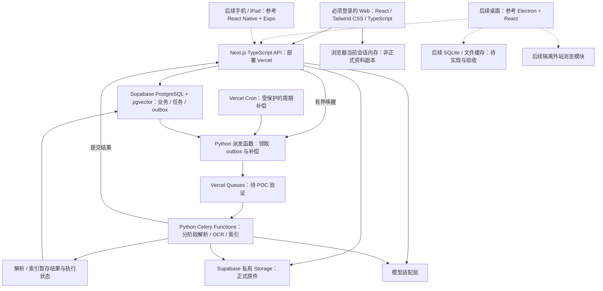

# Conuo（可诺）技术选型与架构说明

> 当前部署状态：2026-09-20 已创建独立 staging：27 份迁移已应用，Web 已部署到 https://conuo-staging.vercel.app，分钟级整理调度及三条清理 Cron 已配置。上传、跨账号隔离、双会话 CAS、真实模型后台整理、主要业务冲突接口、孤立上传清理、带数据删除／注销主链路、真实注册确认邮件、同浏览器 PKCE、真实等待后的过期 signup token 与 Chrome／Edge 持久会话自动刷新已通过；真双设备、断网、自然 Cron、真实找回密码邮件与跨浏览器邮件仍待验收。staging 从 GitHub `staging` 分支自动部署，原生产 Vercel 保持 `main` 且已关闭 Preview 自动部署；原生产数据库未升级，生产代码与 schema 可能不一致。完整验收基线 SHA `5f6b50ff99ae558cf2738a053dea79fb2fcfe77a` 已验证；可变域名当前运行版本始终以无缓存 `/api/health` 返回的分支与完整 SHA 为准。详细证据见 [Staging 部署与验收](STAGING_DEPLOYMENT.md)和[生产发布手册](PRODUCTION_RELEASE.md)。

> 陪你把知识学会。

| 文档属性     | 内容                                                                                                                                                                                                                                                                            |
| ------------ | ------------------------------------------------------------------------------------------------------------------------------------------------------------------------------------------------------------------------------------------------------------------------------- |
| 版本 / 日期  | v0.16 / 2026-09-15                                                                                                                                                                                                                                                              |
| 选型状态     | 用户确认 React + Tailwind CSS + TypeScript 前端、Next.js TypeScript 后端、Supabase 数据库、Auth 与 Storage，以及 Vercel 部署；保留 Python 处理层                                                                                                                                |
| 实现状态     | 已建立 Web、版本阅读与审核、普通类型化搜索、规范化资料/版本/内容块、pgvector 混合检索和 Python 有界索引处理器；独立 staging 已应用 27 份迁移并部署 Web／整理调度，真实上传、A/B 隔离、双会话 CAS、模型整理与业务冲突响应已验证；Embedding、真双设备、生产升级及完整 M0 尚未验收 |
| 对应需求     | [PRD](PRD.md) 第 7—12、15—17 节                                                                                                                                                                                                                                                 |
| 当前交付范围 | 首版 Web 必须登录且仅云端正式存储；只有后续桌面本地与云端共存，其他平台在 Web 基本完善后启动                                                                                                                                                                                    |

本文区分两类内容：第 1 节的 Web 首版基础技术栈是已确认方向，桌面与移动路线留到后续平台启动时复核；具体模块拆分、目录结构和实现规则是工程建议，尚待原型验证。Celery / Vercel Queues 接入仍须通过 POC-05；资料／知识整理已有较小的 Node.js 持久任务切片，已部署至独立 staging。用户已确认 Supabase 数据库、Auth 和 Storage；Realtime 仍待选择。

**实施顺序：先交付并完善 Web，再评估其他平台的迁移或重新实现。** 文中的桌面、移动与 iPad 设计保留为后续参考，首版不安排原生端工程、组件选型验证、签名和打包。清晰的服务端数据与 API 契约服务于当前 Web，也为后续接入保留空间。

**2026-09-15 已确认存储边界：Web 全部正式资料在云端。** Web 必须登录，以 Supabase PostgreSQL 和私有 Storage 保存业务正文、版本、引用、原件、对话与阅读位置。浏览器只保存当前会话内存和必要认证 Cookie；刷新从云端读取，没有匿名日常工作区、持久离线编辑或本地草稿退出。断网、认证失效或云端首次读取失败不退回本地工作区。仅后续 Windows／macOS 桌面版采用本地与云端共存，SQLite／文件缓存只是后续参考，尚未实现或验收。

**当前代码与目标架构的边界：** `apps/web` 已提供解析、阅读、笔记、普通搜索与账户保存；003 迁移让 `save_workspace` 在同一事务中维护真实资料、不可变版本、内容块和持久向量任务。云端搜索与问答已读取规范化资料 RPC，pgvector 只读取已发布且配置匹配的当前版本。`apps/processor` 是显式运行的 Python 有界 CLI，尚未部署云调度，解析仍在浏览器执行。JSONB 快照仍承担客户端兼容保存协议并受 3 MiB 限制；笔记、对话、消息、批注、知识关系与知识库书架读投影均已应用到连接的开发 Supabase。资料／知识整理的私有任务表、受保护的 Node.js processor 与恢复逻辑位于本地迁移 `20260914120700_organization_jobs.sql` 和 `apps/web`，已在独立 staging 应用并部署调度。关系参与检索、这些投影的独立写入合同、其他实体规范化和规模验证仍待完成。操作见 [搜索与索引](SEARCH_INDEXING.md)，进度以 [实施状态](IMPLEMENTATION_STATUS.md) 为准。

**Web 会话导入与协调器兼容：** `WorkspaceCoordinator` 在 `storageMode: "cloud"` 下使用 `createWebCloudWorkspaceIO()` 注入 `WebSessionStore`，沿用原有 IO 合同、导入原子准入和 `_conuoLocalRevision` CAS，但这些“local”兼容字段仅表示当前页面内存版本，不表示 IndexedDB 持久保存。SHA-256 判重、字节核验、工作区容量与原件身份保护仍执行；原件上传到私有 Storage，业务快照通过服务端 revision 保存到 PostgreSQL。`updateDurably` 和备份恢复在 Web 模式下等待云端确认，响应丢失先读取权威结果，对象键顺序变化不应误判为内容冲突，数组顺序仍有意义。切换账号、退出或页面释放后清除会话内存；刷新重新 GET 云端，首次 GET 失败不能 PUT 空资料库。

**旧版本 IndexedDB 设计记录：** 旧浏览器客户端曾以覆盖 `workspaces + blobs` 的 `readwrite` 事务原子写入原件、资料及导入任务，执行 SHA-256 判重、本机容量检查和 `_conuoLocalRevision` CAS，防止孤立原件与旧标签页覆盖。相关 `local-store` 实现和测试保留用于旧副本显式读取、备份恢复与兼容验收，不再是 Web 日常存储方案，也不代表桌面 SQLite 已开发。旧副本不自动清空、覆盖或去重；迁入非空账号使用独立恢复 ID，保留原内容，直到确认云端成功也不默认删除旧字节。具体边界见 [WEB_CLOUD_STORAGE.md](WEB_CLOUD_STORAGE.md)。

**生成式接入增量：** 服务端已提供可配置的 Chat Completions 适配器，以及从当前授权原文构建问答、摘要、比较和资料整理上下文并绑定引用的链路。`document-notes` 是受限的单资料范围：只能加入当前问答空间中、明确标记 `aiGenerated: false`、已接受、未删除、且全部引用精确指向该资料当前版本的普通笔记块；它们以独立个人笔记证据传给模型，并记录空间、资料、资料版本和笔记块快照。API 在调用前后复核账号、提问范围、资料版本与 AI 权限；请求账本的迁移位于 `supabase/migrations/202609120002_ai_requests.sql`，按账号预占次数与处理重复请求。2026-09-15 已在被 Git 忽略的本地环境中配置现有服务端请求账本密钥，并使用真实账号完成 DeepSeek `deepseek-flash` 问答、PDF 区域视觉及开发页面资料／知识整理；人工接受的标签、知识页正文和引用已云端保存并刷新恢复。可选 `CONUO_MODEL_THINKING_MODE` 供支持该扩展的供应商使用，当前配置为 `disabled`；文本、流式与图片共用配置，四处请求指纹包含模式，预算仍为 4096，不自动重试。普通检索保持严格快照核验；问答允许同账号、范围和依据均未变化的较新检索 revision，以免合法对话保存导致误拒绝。独立 Embedding 服务、生产持久调度、真实跨账号／跨设备并发和代表性模型质量评估仍待完成；已登录云端但未配置生成模型时保留基于授权原文的检索／抽取模式；这不构成本地日常工作区。配置见 [MODEL_SETUP.md](MODEL_SETUP.md)。

`SUPABASE_SECRET_KEY`（旧项目可用 `SUPABASE_SERVICE_ROLE_KEY`）只放 Next.js 服务端，不能使用 `NEXT_PUBLIC_` 前缀。特权客户端用于生成请求账本、受保护索引动作和字符预算 RPC；普通检索仍经过用户身份与范围检查，Python 不持有数据库特权密钥。生成缓存正文超过 24 小时、元数据超过 7 天时，由同一账号下次预占请求惰性清理；没有定时清理，也不等于完整删除生命周期。生成请求账本与 003 的持久索引 outbox/租约队列分开。

**资料／知识整理的持久队列（staging 已部署）：** `/api/v1/organize` 仍承接资料摘要、标签／主题建议、知识页更新建议和关系建议的模型协议。浏览器中的 `OrganizationRunner` 负责发现自动候选并提交请求；单份资料分析（`source`）和 1—10 份资料的主题草稿（`knowledge`）可写入私有服务端队列，不再由浏览器长时间等待模型。迁移 `20260914120700_organization_jobs.sql` 用请求与上下文摘要、租约、有限重试、暂存结果和发布时复核保护任务；`organizationJobs` 是当前 Web 云端 JSONB 的用户可见审核投影，浏览器只在当前页面内存暂存；旧 IndexedDB 投影仅供兼容，最多 1000 项且共用 3 MiB 工作区上限。资料版本或 AI／自动分析依据变化会使旧任务取消或不能发布，关闭页面本身不会取消已成功入队的任务。知识页更新和双页关系建议仍跟随浏览器交互，尚未采用这条持久队列。

独立 staging 已应用队列迁移，部署 `/api/internal/organization-processor`，配置服务端模型、Supabase 密钥和独立处理器密钥，并通过 Supabase 分钟调度完成真实任务；原生产环境未升级。只有在应用迁移、设置这些服务端变量并由受信任调度器周期调用受保护 processor 后，资料／知识任务才能在生产环境连续运行；Cron 的重复或漏调由持久状态、租约和恢复领取处理。设置页仍可预览并清理已收起、失败和已停止的终态投影，已接受的标签、知识页和关系独立保留。

标签只经用户勾选追加，`tagsLocked` 和 `tagsRevision` 防止覆盖固定标签或错误撤回人工修改；主题逐个接受、编辑为草稿或忽略，不自动重写旧知识页。KNO-03 已提供完整结构块的差异审核与选择性应用，保留正文及引用历史，人工修改后旧建议失效。KNO-04 已提供同义词候选、相关概念、前置知识和冲突观点的双页关系记录，支持手动建立、AI 建议审核、编辑和可恢复删除。关系保留两侧观点、条件、引用与 AI 来源，通过双方页面快照和关系 revision 保护后续修改。具体操作见 [ORGANIZATION.md](ORGANIZATION.md) 和 [RELATIONS.md](RELATIONS.md)。普通搜索已包含笔记和已接受知识页，草稿默认排除；除受限的 `document-notes` 范围外，新 AI 证据仍限原始资料。真实模型质量、跨设备、云部署和完整后台解析仍需验收。

笔记、知识页及已保存历史版本已支持 GFM Markdown、安全 HTML 和原始正文导出，保留路径与引用映射；相关对话消息还会独立导出个人笔记证据快照，历史版本缺少独立引用快照时不附加当前引用。格式保留范围和恢复边界见 [EXPORT_FORMAT.md](EXPORT_FORMAT.md)。

**文件版本增量：** PDF、DOCX、Markdown、TXT 可在阅读器中预览后明确换版，支持格式互换。`prepareFile` 仅解析、计算指纹和生成内存候选；协调器校验实际字节，以不可覆盖写入保存并回读原件后，再按预期版本一次性更新资料与历史。当前相同 SHA-256 拒绝重复版本，匹配历史内容需用户额外确认。版本记录也可在显式确认后把一个确切历史版恢复为当前内容，并以 CAS 前提归档操作前的当前版；版本身份、原件和引用不重建，资料级人工元数据与权限保持。历史版本单独清理经由云端 CAS/影响指纹事务，删除精确版本的投影与派生索引，并复用资料清理 Storage outbox；用户笔记和对话保留不替代的失效历史引用，保存批注、手工关系和进行中的任务会阻止操作。工作区持久化与云端同步仍由保存队列执行，不是原件与云端快照的跨服务事务。上传队列遍历当前及全部历史原件，完成路径只回填准确版本；ZIP 逐版导出原件。每文件 30 MiB、每资料 200 个历史版本，全部文字与片段计入 3 MiB 工作区上限；仍在浏览器解析。操作与边界见 [FILE_VERSIONS.md](FILE_VERSIONS.md)。

`conceptRelations` 是工作区快照中的可选字段，最多 2000 条（含已删除记录），与其他内容共用 3 MiB 容量。第 15 份迁移已在连接的开发 Supabase 应用，事务性维护 `concept_relations` 只读投影；浏览器仍以 JSONB 快照作为唯一写入权威。关系生成只由用户发起；两个基线快照合计 120 KiB 预检为模型结果留出空间，服务端仍另行校验完整结果大小。关系独立导出包含当时的两页快照与当前可用性，不把现有页面替换为旧基线，也不因关系被接受就加入问答检索。

## 1. Web 首版技术栈与后续参考

| 范围                         | 技术选择                                           | 主要职责                                                               | 使用边界                                                           |
| ---------------------------- | -------------------------------------------------- | ---------------------------------------------------------------------- | ------------------------------------------------------------------ |
| Web 前端                     | React + Tailwind CSS + TypeScript，使用 Next.js    | 资料库、阅读、笔记、知识页与 AI 对话页面                               | 响应式 Web；页面与业务 API 位于同一 Next.js 工程                   |
| Web 应用入口                 | Web App Manifest、安装图标、根布局元数据与设置提示 | HTTPS 部署后支持浏览器添加到桌面或主屏；不提供服务工作线程或完整离线包 |
| 后续 Windows / macOS         | 此前 Electron + React 路线作为参考                 | 未来桌面多栏、本地文件、SQLite／文件缓存与云端共存、内置浏览           | 首版不开发；平台启动时根据 Web 成果复核复用与重新实现范围          |
| 后续 Android / iPhone / iPad | 此前 React Native + Expo 路线作为参考              | 未来触摸阅读、移动收集与系统分享                                       | 首版不开发；原生阅读、分享和笔迹在平台启动后验证                   |
| Web 编辑器                   | Tiptap                                             | 富文本笔记和知识页编辑                                                 | 先验证 Web 体验；后续平台的使用方式另行评估                        |
| Web PDF 阅读器               | PDF.js                                             | PDF 展示、文本层与阅读基础                                             | 批注、位置映射、跨版本引用和回跳由项目设计实现                     |
| 业务服务端                   | Next.js + TypeScript，Node.js Route Handlers       | 账号权限、资料与笔记、同步、交互 AI 问答、任务创建与结果发布           | 提供稳定 HTTP API；后台文档处理独立于交互请求                      |
| Web / 业务 API 部署          | Vercel                                             | Next.js 构建、页面交付与服务端函数运行                                 | 具体项目配置、地区与套餐待定；后台接入见第 6、9 节                 |
| 业务数据与向量               | Supabase 托管 PostgreSQL + pgvector                | 笔记、版本、资料关系、内容块、标签、任务记录和向量索引                 | 需配置数据库权限、连接池和索引；检索质量须实测                     |
| 账号认证                     | Supabase Auth                                      | 注册、登录、邮箱确认、密码恢复与会话                                   | 服务端验证用户身份；原生端凭证流程留到后续平台启动时设计           |
| 大文件存储                   | Supabase Storage                                   | 原始文件、网页快照、附件与派生文件                                     | 私有桶与账号隔离策略；地区和套餐待定，数据库保留对象元数据与权限   |
| 后台处理语言与任务层         | 已有 Python 3.12 有界 CLI；Celery 保留为部署候选   | 当前向量化已有切块，后续解析、OCR 和耗时整理另行实现                   | CLI 默认 5 项 / 40 秒，需显式运行；尚未部署 Celery、队列或唤醒服务 |

基础能力参考：[Tiptap 的 React 集成](https://tiptap.dev/docs/editor/getting-started/install/react)、[PDF.js 项目说明](https://mozilla.github.io/pdf.js/)、[pgvector 官方仓库](https://github.com/pgvector/pgvector)。这些来源说明组件用途，不证明 Conuo 的阅读、检索或学习质量已经达标。

Supabase 的 PostgreSQL 可使用 pgvector 存储和查询向量；选用该扩展不等于自动完成文档解析或 AI 标注。[Supabase pgvector 说明](https://supabase.com/docs/guides/database/extensions/pgvector)

当前依赖版本已写入 `apps/web/package.json` 和根锁文件，使用 npm 工作区；具体版本与验证记录以代码为准。Supabase 与 Vercel 已由用户指定，登录与对象存储已进一步确认采用 Supabase Auth 和 Storage；模型服务、服务地区与套餐在真实接入前落实。

## 2. 选择这条路线的理由

### 2.1 后续手机和平板参考路线

手机和平板独立客户端在 Web 功能基本稳定后再启动。届时针对触摸、键盘、拍照与系统导入设计界面，评估 React Native + Expo 是否适合复现 Web 已验证的功能。首版响应式 Web 与原生客户端分别验收。

React Native 的 Windows、macOS 和 Web 实现存在，但属于独立维护的平台扩展。此前桌面路线采用 Electron，后续启动时仍需根据实际功能复核，不能把移动库的可用性直接外推到桌面。[React Native 官方平台说明](https://reactnative.dev/docs/out-of-tree-platforms)

### 2.2 Web 先实现，后续按需复用

首版先在 Next.js 中实现资料列表、知识页、编辑器及 AI 对话。后续若采用 Electron，可提取适合共享的 React 客户端组件；确需共享时再隔离 Next.js Server Components、会话与服务端路由依赖。桌面窗口、本地文件、快捷键和外站浏览的适配层在对应平台启动后实现。

React 负责组件，TypeScript 负责类型，Tailwind CSS 负责 Web 样式；Next.js 提供路由、渲染与服务端入口，这些选型组合在同一工程。后续若提取共享组件，再验证不同客户端的样式构建；React Native 原生样式及 NativeWind 等库届时评估。[Tailwind CSS 的 Next.js 集成](https://tailwindcss.com/docs/installation/framework-guides/nextjs)

若后续采用 Electron，参考方案是本地 React 入口和缓存适配层连接远程 Next.js API。Next.js 静态导出不能保留依赖服务端运行时的功能，迁移时需识别这些边界，不能把完整 Web 服务直接当作桌面离线包。[Next.js 静态导出说明](https://nextjs.org/docs/app/guides/static-exports)

Electron 随应用包含 Chromium 和 Node.js，并提供 WebContentsView 以承载网页。此前选型主要考虑文档界面复用及外站浏览，后续仍需评估运行时体积、资源开销与更新维护。[Electron 简介](https://www.electronjs.org/docs/latest)、[WebContentsView](https://www.electronjs.org/docs/latest/api/web-contents-view)

### 2.3 备选方案的位置

Tauri 与 Flutter 是讨论过的替代方案，本版不同时维护多套客户端路线。Tauri 使用系统 WebView，若以后安装体积成为主要问题，可基于实际目标网站与编辑器测试重新评估；Flutter 覆盖多种平台，若团队条件或产品交互方向改变，也可另立选型记录。[Tauri WebView 说明](https://v2.tauri.app/reference/webview-versions/)、[Flutter 平台支持](https://docs.flutter.dev/reference/supported-platforms)

更换方案应由未通过的原型或实际维护成本驱动，并记录迁移范围；不能只凭框架宣传中的“一套代码多端”作决定。

### 2.4 Next.js 统一 Web 与业务 API

用户已决定采用 Next.js。其 Route Handlers 能提供由各类客户端访问的 HTTP 接口；本项目用它承接账号权限、资料、笔记、同步及交互问答。Server Actions 仅作为 Web 页面内部交互的可选实现，不承担全部客户端唯一接口的角色。[Next.js 后端接口说明](https://nextjs.org/docs/app/guides/backend-for-frontend)

该 Next.js 工程部署到 Vercel，首版只交付 Web。后续客户端可以访问其业务 API，安装包届时按平台构建与发布。Vercel 对 Next.js 的部署及流式响应提供框架集成，实际配置与链路表现仍须验证。[Next.js on Vercel](https://vercel.com/docs/frameworks/full-stack/nextjs)

该选择便于 Web 与业务服务围绕 TypeScript 组织，代价是任务处理层仍使用 Python，需要维护跨语言契约和明确的数据写入责任。框架不会替代持久任务队列、数据库、对象存储或云同步协议。

## 3. 建议架构与责任边界



图示表达本版建议的 Vercel 部署路径，队列接入须经 POC-05 验证。Next.js Web 与业务 API 位于同一工程，Python 派发与 Celery 任务位于同一处理层代码库，分别以有界函数执行。为便于隔离构建，可先规划同一仓库对应两个 Vercel 项目：Web 工程与 Python 处理层；此为工程建议，尚未创建云项目。两种语言通过契约和受限数据接口协作，不共享运行时领域对象或同一套 ORM 实体。结果发布失败时由持久状态与补偿机制恢复。

| 模块                    | 负责                                                                   | 不承担                                                 |
| ----------------------- | ---------------------------------------------------------------------- | ------------------------------------------------------ |
| 客户端                  | Web 展示、用户输入、当前会话内存与调用受控接口；桌面本地层后续独立实现 | 保存服务端模型密钥；自行决定服务端权限                 |
| Next.js 业务层          | 权限判定、业务规则、版本写入、交互问答、创建任务及发布处理结果         | 在请求进程中执行耗时 OCR 或批量索引                    |
| Python 派发函数         | 有界领取待派发记录、调用 Celery 客户端、补偿遗漏投递与结果提交         | 自行创建未经授权的业务任务；以入队成功代替处理成功     |
| Celery 处理函数         | 校验任务、执行阶段任务、保存暂存结果与执行状态、提交结果               | 直接覆盖用户笔记；自行发布未经最新权限和版本校验的结果 |
| Supabase PostgreSQL     | 业务数据、任务状态、版本与引用依据                                     | 保存所有原始大文件；自动判断应用账号权限               |
| pgvector                | 语义召回的索引                                                         | 原始资料唯一副本；最终答案正确性的证明                 |
| 对象存储                | 文件字节与版本对象                                                     | 自动解决笔记同步、引用失效或访问授权                   |
| Vercel Queues（待验证） | 传递任务并触发处理函数                                                 | 替代业务任务状态、幂等与重试规则                       |
| Redis（备选）           | 常驻处理层备选方案的 broker                                            | 当前 Vercel 首选路径的必需依赖；用户内容唯一副本       |

### 3.1 各端统一 HTTP API

资料、笔记、同步、任务查询和 AI 问答通过版本化 HTTP API 提供，建议使用 `/api/v1/` 路径。接口规定请求与响应结构、鉴权、错误码、幂等键和流式事件格式。首版供 Web 使用，后续平台可接入同一业务服务；Route Handlers 与可选的 Server Actions 共用服务端领域函数，避免复制权限、额度和版本规则。

每个业务入口都在服务端进行账号和对象权限检查。首版落实 Web 会话；移动 / 桌面凭证在后续平台启动时设计，不能默认浏览器 Cookie 自动适用于原生客户端。当前 `/api/internal/indexing` 已验证独立 Bearer 服务秘密与模型配置指纹，只开放受限索引动作，并通过 SQL 租约和发布复核保护内容；部署后的身份和网络边界仍需联调。

Python 派发入口仅接受受信服务或定时补偿调用。若使用两个 Vercel 项目，普通 HTTP 入口不因名称含“internal”而自动私有；派发和回调两方向都须验证服务身份、允许的任务及环境。用户客户端只调用 Next.js，不直接接触队列或 Python 控制入口。

### 3.2 数据写入与迁移责任

下表保留包含服务端解析的目标职责。当前落地的是 Next.js 经受限 RPC 同步资料/版本/块、创建向量任务并发布结果；Python 仅经 HTTP 提交已存在块的向量，不解析文件、不直接写数据库。

| 数据范围                                   | 写入责任                                                        | 并发与权限边界                                                                                                                        |
| ------------------------------------------ | --------------------------------------------------------------- | ------------------------------------------------------------------------------------------------------------------------------------- |
| 用户、空间权限、资料元数据、笔记与同步版本 | Next.js 业务层                                                  | 所有写入经过业务鉴权、版本与额度规则                                                                                                  |
| 业务任务、待派发记录、取消请求             | Next.js 创建；派发器领取和更新派发状态；worker 更新受限执行状态 | 明确状态转换与任务身份，不能各语言任意修改所有字段                                                                                    |
| 解析块、向量与派生文件暂存结果             | Python worker                                                   | 只写当前任务及处理尝试对应的输出，绑定资料版本，完成后尚不可直接发布                                                                  |
| 正式可用索引、知识草稿、成功状态与业务结算 | Next.js 结果提交处理                                            | 在同一事务内重查资料版本、权限及取消状态，AI 任务额外检查 AI 许可，再发布当前任务结果；普通索引不因关闭 AI 被拒绝，不直接覆盖用户正文 |

数据库 schema 与迁移的当前权威来源为 `supabase/migrations`。TypeScript 和 Python 使用同一版本化 HTTP/RPC 契约，不各自生成迁移；Python 不直接写表。003 已实现每 owner 事务锁序、行锁领取、租约 token、分批 cursor 和原子发布；真实多连接竞争仍需验证。后续若抽取 `packages/database`，须保留单一迁移历史，不重写已应用的迁移。

### 3.3 Supabase 数据库接入

Supabase 承担 PostgreSQL 托管职责，原件仍进入对象存储。003 已建立资料、保留版本、内容块、向量和任务表，保存快照时原子同步，正文/定位不可覆盖。笔记读投影已在连接项目应用；对话、消息、批注、知识关系与知识库书架读投影已在本地准备。它们仍由工作区快照事务性生成，尚未建立独立写入合同；块级标签和检索质量仍需独立细化与评估。

Vercel 上的 Next.js 与 Python 函数建议通过 transaction pool 访问数据库，限制每个实例的应用连接池，并按驱动关闭不兼容的 prepared statements。事务内完成任务与 outbox 的原子写入，避免依赖跨事务会话状态；迁移使用单独、受控的连接配置，并核验网络与驱动兼容性。[Supabase 连接指南](https://supabase.com/docs/guides/database/connecting-to-postgres)

当前 Next.js 通过 Supabase Data API/RPC 访问数据库；Python 只调用 Next.js 内部 HTTP。规范化表禁止调用者直接读写，保存、用户检索/任务控制和 service-only 执行/预算分别授予明确 RPC 权限，并在函数内复核 owner 与当前状态。后续直接 SQL 连接池属于部署候选，不是现有 Python 的连接方式。数据库密码、服务端 secret / service-role 密钥不进入浏览器、桌面或移动安装包；高权限身份可能绕过 RLS，不能仅凭“已开启 RLS”推断所有访问均隔离。[Supabase API 安全](https://supabase.com/docs/guides/api/securing-your-api)、[RLS 权限边界](https://supabase.com/docs/guides/database/postgres/row-level-security)

本项目建议为 Next.js、Python 派发与执行、迁移流程分别定义最小数据库权限。通过 SQL 连接时不会自动获得应用登录用户身份；账号条件与对象范围由受信服务核验并传入查询，若采用按账号 RLS，需明确事务内身份上下文及连接复用时的隔离。权限约束同样覆盖向量检索、标签筛选与结果发布。

迁移在受控流程中执行，不由每次页面构建、预览部署或用户请求自动改写正式数据库。开发、预览和生产的数据库及处理环境须隔离；具体实现可选择独立项目或适用的隔离能力，套餐与恢复方案接入前核验。

## 4. 代码复用与建议目录

以下为 Web 与后台工程的目标结构；`apps/web` 已创建，其余处理服务与共享包尚待实现。先按 Web 实际模块组织，`packages` 只在边界明确或确需复用时提取，不要求一次搭建所有包：

```text
conuo/
├── apps/
│   └── web/                # React / Tailwind / TypeScript 页面与 Next.js API，部署 Vercel
├── packages/
│   ├── contracts/          # 版本化 OpenAPI / JSON Schema、任务与结果契约
│   ├── api-client/         # 客户端接口封装与错误处理
│   ├── domain/             # Web 的可移植纯 TypeScript 规则，按需提取
│   ├── server-domain/      # 仅 Next.js 服务端使用的权威业务规则
│   ├── database/           # Supabase PostgreSQL 权威 schema 与迁移来源
│   ├── web-ui/             # Web React DOM 组件与 Tailwind 样式，按需提取
│   └── design-tokens/      # 色彩、间距与排版变量
├── services/
│   └── processing/         # Python 处理层，建议独立 Vercel 项目
│       ├── dispatcher/     # 受保护的有界派发与补偿入口
│       ├── workers/        # Vercel Celery 订阅入口、阶段任务与结果提交
│       ├── contracts/      # 从权威契约生成或校验的 Python 数据结构
│       └── adapters/       # 文件解析、对象存储和模型接口
└── docs/                   # PRD 与技术方案
```

建议用单一仓库管理，TypeScript 工程和 Python 处理层各自锁定依赖。Next.js 的页面与 API 使用其构建体系；首版不创建 `apps/desktop`、`apps/mobile` 或原生构建配置。包管理器、构建编排工具、ORM 和迁移工具在初始化时再确定；后续平台启动后再扩展目录与构建工具。

后续优先评估复用契约、数据、可移植规则与接口封装，界面可按平台重新实现；不以复用率作为 Web 首版验收指标。React DOM 组件不能未经处理直接用于 React Native；`server-domain` 和数据库访问代码不能打包进客户端。Next.js 负责最终权限、版本与额度判定，Python 执行层按契约读取必要状态，不能直接导入 TypeScript 业务对象。

跨语言任务与结果采用版本化 JSON 契约，至少包含 schema 版本、任务 ID、执行尝试 ID、账号 / 空间 / 资料版本标识、处理配置和幂等键。身份字段只是任务上下文，不替代鉴权；TypeScript 与 Python 分别从同一契约生成或校验数据，协议不兼容时明确失败，不能静默忽略关键字段。

## 5. 阅读、编辑与浏览实现边界

### 5.1 阅读和引用

当前 Web 的 PDF.js 阅读器支持单页与连续滚动，同一资料版本只加载一份 PDF 文档，切换模式、页码或缩放不重新下载。连续模式保留每页占位，视口附近最多 5 页持有 Canvas／TextLayer，远页释放像素与文字层；页码反馈与显式导航分开，避免滚动反馈触发跳页。模式及可用页内比例为会话显示状态，正式进度通过已有云端 `readPage`／`lastReadAt` 合同保存，滚动先 400 ms 合并再按 15 s 活动间隔同步，离开时提交待报告进度。原生选区检查真实 TextLayer 页身份，批注精确位置仍单独核对原文投影；查找限定当前物理页，全文查找使用解析文本。详见 [PDF 阅读模式](PDF_READING_MODES.md)。

首版从 Web 的 PDF.js 原型开始。后端解析结果至少保留资料 ID、资料版本、页码及可用的位置标记；Web 批注和 AI 引用使用同一套定位契约。页内坐标、文本偏移及解析块之间如何映射，由 POC-01 确定，不能只保存页码或一次渲染时的屏幕坐标。桌面与移动阅读器在后续启动时对接此契约。

原文件更新后不得把旧引用悄悄指向新版的相似文字。引用随原资料版本回跳，过期与不可用状态按 PRD 展示。扫描件的展示和 OCR 是否成功分开记录。

当前 Web 按 `Source.versions` 保存各版格式、文件名、正文、片段和原件位置，003 将全部保留版本同步为规范化行；资料名称、标签、归属、收藏与 AI 权限仍属可变身份。历史 PDF 即使当前资料已换为 DOCX，仍按旧原件阅读。历史可核对引用和另存摘录，禁止新 AI、新标注及当前进度回写；新问答和整理只检索当前版。`document-notes` 也只接受引用当前版本的人工笔记，不能把旧版本笔记引用作为当前资料证据。服务端索引发布已校验版本与权限，原始文件解析仍在浏览器，完整跨服务原件发布和恢复流程仍待验收。

### 5.2 笔记与移动端编辑

Tiptap 首先用于 Web，采用可版本化的文档结构。首版验证中文输入法、选区、自动保存、重载及短暂断网后的草稿恢复；手机和平板浏览器按 Web 响应式范围验证。服务端校验节点和附件引用，导入或渲染外部内容时不直接信任原始 HTML。

后续移动客户端启动后，可验证 WebView / Expo DOM 编辑区或原生阅读组件。前者能复用部分 Web 内容，但有独立执行环境和异步数据传递边界，不能假设与原生界面直接共享全局状态。[Expo DOM 组件说明](https://docs.expo.dev/guides/dom-components/)

后续平台的 POC-06 包含中文输入法、选区、软键盘遮挡、长文滚动及切后台后的草稿恢复，并独立验证 iPad 手写与 PDF 缩放对齐。原生缓存和笔迹组件届时选择，不作为 Web 首版启动或发布条件。

### 5.3 内置浏览器

首版只实现 Web 的链接导入、阅读快照和外部打开。以下桌面与移动浏览容器规则保留到对应平台扩展时实施；不在 D0 或 M0 创建原生浏览器原型。

当前代码已提供 `/api/v1/web/preview` 的公开 HTML 抓取与 Readability/JSDOM 正文预览，用户确认后保存正文、连续选段或仅链接。原始/最终 URL、采集时间与范围随工作区导出；Node 请求逐跳验证公网 DNS 并固定 IP，禁止脚本和资源加载。已有网页可在明确预览与确认后刷新：保留资料 ID，生成新版本与切块，旧内容归档至可选 `Source.versions`。历史阅读和引用按版本定位，新问答及整理仍只使用当前版；`document-notes` 中的个人笔记也必须全部引用该当前版。保存比较预期版本并检查包含全部历史的 3 MiB 容量，不裁剪旧版本。003 已接入规范化版本和任务失效规则；真实多设备与云端并发仍待验证。约束及旧本机兼容／当前云端身份边界见 [网页导入](WEB_IMPORT.md)。

- 桌面在独立的 WebContentsView 中加载外站；应用资料界面与外站属于不同的权限边界。
- 外站禁用 Node.js 集成，启用上下文隔离与进程沙箱。导航、弹窗和权限申请受控，不向网页暴露通用文件系统或高权限应用接口。[Electron 安全说明](https://www.electronjs.org/docs/latest/tutorial/security)
- 移动端使用相应的网页承载能力，具体组件与系统登录、下载、弹窗行为通过 POC-02 确定。浏览 Cookie 不进入资料云同步，应用登录凭据不向外站传递。
- Web 端保留链接导入、阅读快照和外部打开；受站点嵌入策略限制，不保证任意网址在页内打开。[MDN：X-Frame-Options](https://developer.mozilla.org/en-US/docs/Web/HTTP/Reference/Headers/X-Frame-Options)
- 打开网页、提取正文、将正文用于 AI 是三个独立状态。登录后可阅读的页面不等于后端可以直接获取；优先由用户在当前浏览会话中主动保存可提取内容，并明确失败状态。

网页文字和上传文档均作为资料处理，不作为控制应用权限、工具或后台任务的指令。

## 6. 数据、检索与后台作业

### 6.1 一份资料的处理流程

以下是包含服务端解析的目标流程。当前实际路径为“浏览器解析 → 原件上传 → `save_workspace` 原子同步版本/块与可选索引任务 → 显式 Python CLI 分批向量化 → Next.js/SQL 复核发布”；尚未实现下面的 Python 文档解析、Storage 实物完整性登记、Celery 派发及自动补偿唤醒。

1. Next.js 业务层校验用户、空间权限、文件类型和当前额度，创建资料及上传记录。
2. 客户端使用受限上传凭证直传对象存储；Next.js 确认对象存在、归属、大小和类型等实际属性与记录匹配后登记版本。凭证限制对象路径、有效期及可用操作；不信任客户端单独提交的“上传成功”。
3. Next.js 在 Supabase 同一数据库事务中创建业务任务及待派发记录。事务提交后可有界调用 Python 派发入口以降低排队延迟，调用失败由补偿恢复。Python 领取记录，使用 Celery 原生客户端经 Vercel 适配投递；任务只携带对象标识与必要配置，不把整个文件塞进队列。
4. worker 检查任务、资料版本和当前处理条件后，按资料处理设置执行非 AI 的文本解析和普通关键词索引，保存带来源位置的暂存内容块与解析覆盖状态。OCR 若需要模型参与，也须先检查用户已启用 AI 且资料允许用于 AI。
5. 仅在用户已启用 AI 且资料允许用于 AI 时执行向量化、模型辅助检索准备及生成任务。worker 提交暂存结果后，由 Next.js 按第 3.2 节重新校验并发布。普通搜索可用状态与 AI 可用状态分别记录，关闭 AI 不隐藏普通搜索中的资料。
6. 用户提问时重新校验范围与权限，检索候选内容，结合来源生成回答与可回跳引用。
7. 保存知识页时记录所用来源版本；原资料删除、禁用或更新后按 PRD 更新派生内容状态。

### 6.2 检索设计

**当前已实现：** 普通搜索区分资料、笔记和知识页，草稿默认排除；当前 Web 按登录账号读取云端资料，原始资料来自规范化 RPC，笔记／知识页暂从云端账号快照生成候选；旧本机检索仅兼容，未登录不能进入日常资料库。类型/标签/日期先确定允许范围，再取数据库候选。普通全库可包含归档库的未删除资料，AI 则排除仅有归档归属的来源。普通新问答仍仅使用原始资料；仅 `document-notes` 能以至多 4 个、合计 8,000 字符的同空间同资料当前版本人工笔记块补充上下文，原始引用和个人笔记依据分别保存。语义未就绪时保留关键词，总结继续原文轮询采样。

向量 profile 固定为 `embedding-v1`、1536 维，首次 claim 绑定 Base URL、模型和维度指纹，禁止换配置后混用。显式语义搜索仅开放具体库/收件箱；需要 `semanticSearch`、全局 AI、资料权限和匹配的已发布当前版。数据库已提供余弦索引，服务端使用 RRF 融合关键词与向量结果；当前中文召回为相邻双字启发式，不称为完成中文分词。详见 [SEARCH_INDEXING.md](SEARCH_INDEXING.md)。

pgvector 用于语义召回；标题、术语和精确短语需要关键词检索补充。中文分词及关键词检索方案应使用真实中英文材料评估，不能默认 PostgreSQL 的任一内置语言配置适合中文。

在 Supabase 的实际扩展版本与数据量下验证权限、资料状态和标签筛选后的召回；不先取全库近似结果再在客户端过滤。受约束查询的性能与召回由 POC-04 验证，数据库供应商不替代检索质量评估。

普通关键词搜索按用户、空间、资料存在状态与可检索内容授权；AI 禁用本身不隐藏标题、标签、普通正文搜索和资料管理入口。向量化、模型辅助检索及 AI 问答额外检查用户已启用 AI、资料版本有效且资料允许用于 AI。`document-notes` 还检查原始问答空间、资料、资料版本、笔记状态、明确人工来源和每条笔记引用，不由客户端传入任意笔记 ID。遵循 PRD 的 SRC-01—SRC-03。

AI 回答输出前应重新检查来源是否仍可用，避免请求执行期间删除或禁用的内容被继续用于 AI。嵌入模型更换时记录索引版本并安排重建，不混用不兼容的向量空间。

首版先验证可解释的检索、引用和知识页更新，不因产品使用“知识库”一词就额外引入图数据库或复杂 Agent 框架。知识之间的关联可先通过关系数据表达，是否需要新基础设施由实际查询和数据量决定。

### 6.3 交互问答与长任务

本轮已实现的后台执行边界为 `apps/processor` 的 Python 3.12 CLI：显式运行，每次最多 5 项/40 秒，读取已有块、提交向量并申请发布。数据库队列持久保存 lease/cursor/重试和取消，Next.js 在披露正文和发布前复核权限；默认每日字符预算独立于生成次数，并非货币上限。尚未安装 Celery 或部署云唤醒；下文的 Vercel 派发/补偿是待验证部署方案，不能视为页面关闭后已自动执行。

资料／知识整理另有一个较小的本地持久任务切片。`20260914120700_organization_jobs.sql` 为 `source` 和 `knowledge` 请求建立私有队列表，持久保存任务请求、上下文摘要、租约、有限重试和暂存输出；Next.js 的 `/api/internal/organization-processor` 使用服务端身份领取、调用模型、暂存并发布已复核的结果。客户端只提交任务并从权威工作区刷新结果，`organizationJobs` 是用户可见投影而非执行真相。知识页更新建议与关系分析仍是浏览器交互链路，未进入该队列。迁移、服务端变量、processor 部署和调度均未在连接环境启用，因此这段实现不能作为已上线后台处理能力描述。

交互问答由 Vercel 上 Next.js 的 Node.js Route Handler 提供流式响应，首版验证事件格式与 Web 浏览器兼容性；原生传输适配留到后续平台。后台处理独立于交互请求。函数的流式响应与队列处理都需要核验时长、内存、包体和临时存储边界；大文件直传对象存储，函数只接收控制请求并按需读取文件。[Vercel Functions 限制](https://vercel.com/docs/functions/limitations)

Vercel 官方 Celery 适配可使用 `vercel://` broker 将 Python 任务交给 Vercel Queues，再触发私有 Python Function；队列处于 Beta。本版建议优先验证此路径，Python 派发改为有界 HTTP 函数，Redis 不再是默认依赖。原 Redis + 常驻派发器 / worker 保留为 POC 未通过时的备选，具体调整另行记录。[Vercel Celery 部署说明](https://vercel.com/docs/frameworks/backend/celery)

任务的创建、运行、结果待提交、成功、失败与取消请求应保存在 Supabase PostgreSQL。采用业务任务 ID、资料版本与执行尝试 ID 标识工作及输出；以下是面向解析、OCR 与 Celery 路径的完整待实现方案。上段资料／知识切片已在本地实现相近的入队、租约、暂存和发布保护，但尚未迁移或部署：

1. **持久创建：** Next.js 同事务写业务任务与 outbox（待派发记录），不能先提交任务再仅依靠一次内存投递。
2. **跨语言派发：** Python 派发函数以有限批次领取到期记录，再调用 Celery 原生 Python 客户端；任务定义和订阅部署在同一 Python 项目。Next.js 不手工构造 Celery 消息信封；环境、队列和协议版本显式对应。
3. **重投与补偿：** 领取记录使用持久租约或等效并发保护；若发布后登记失败，允许再次投递，由任务幂等保护处理。恢复扫描覆盖租约过期、长时间无进展、函数超时和已暂存未发布的任务，入队成功不是最终完成依据。
4. **结果提交：** worker 持久化暂存输出与“结果待提交”状态，向受限的 Next.js 内部接口提交任务与输出标识。Next.js 校验服务身份，在事务内重查当前资料、版本、删除、取消及按任务类型适用的 AI 许可，再启用输出并记录成功与业务结算。被删除或已不适用的结果不发布；生成的知识内容遵守 PRD 草稿规则。
5. **提交恢复：** 若函数退出或结果提交失败，Python 补偿入口扫描已暂存的待提交任务并重试。重复提交使用同一幂等身份；陈旧执行尝试不能覆盖后续结果，原文被禁用 AI 时也不能通过旧任务重新参与 AI。
6. **分阶段处理：** 按资料类型将解析、必要 OCR、切块、向量批次和整理拆成有界阶段，记录检查点与子任务输出。只有当前版本所需阶段完成并通过发布校验，才能进入相应可用状态；部分成功仍按 PRD 显示覆盖范围。
7. **恢复调度：** Vercel Cron 调受保护入口进行有界补扫，每次读取 Supabase 的到期时间、租约和状态后继续处理；频率须满足恢复目标。长延迟重试保存在 `next_retry_at`，不通过在函数中等待实现。

双方只按第 3.2 节的职责写表，不各自维护一份相互冲突的任务真相。Next.js 发布结果不代表接受并合并知识草稿；用户接受知识页修改仍走独立业务操作。

Vercel Celery 适配的默认提前确认会影响超时后的重投，需要验证 `task_acks_late`、处理租约和显式异常重试；长 `countdown` / `eta` 会占住函数执行时间。上述配置必须与阶段幂等及补偿规则一起验证。[Celery 确认与重试](https://vercel.com/docs/frameworks/backend/celery#retries-and-redelivery)

Cron 不能作为精确、只调用一次的保证；漏调或重复调用均从持久状态恢复，记录长时间无进展的任务并提供重试入口。[Vercel Cron 管理](https://vercel.com/docs/cron-jobs/manage-cron-jobs)

Celery result backend 和 Runtime Cache 仅用于可丢弃的执行辅助信息。用户看到的任务状态、输出与用量以 Supabase 为准，不把临时缓存缺失解释为任务尚未执行，也不承诺模型调用只发生一次。[Runtime Cache](https://vercel.com/docs/caching/runtime-cache)

取消先改变业务任务状态，在执行阶段边界及写入前检查；即使供应商无法立即中断请求，也应停止向用户发布已取消的结果，并按实际发生的调用记录用量。模型调用、嵌入和重排序通过适配层接入，供应商仍待选择。

## 7. Web 云端保存与后续桌面共存方案

当前 Web 使用云端唯一正式存储；Supabase 不自动提供版本、幂等、并发冲突或删除协议，仍须按 PRD 第 10—11 节实现。尚未选用 Realtime，也不能把 HTTP 或客户端框架能力描述为已经完成多端协作。Next.js 页面缓存、浏览器内存和临时模型结果不作为保存真相，私有资料与权限结果不得跨账号共享。

| 项目           | 当前 Web 规则                                                                          | 后续／兼容边界                                                                           |
| -------------- | -------------------------------------------------------------------------------------- | ---------------------------------------------------------------------------------------- |
| 账号与初始化   | 未登录只提供登录入口；首次云端读取失败不可编辑、不 PUT 空工作区                        | 不提供匿名日常工作区或断网本地降级                                                       |
| 正式保存       | PostgreSQL 保存业务与 revision，私有 Storage 保存原件；仅服务端确认显示“已保存到云端”  | HTTP 响应丢失先读回结果，避免重复新增                                                    |
| 当前页面暂存   | 内存保存正在上传／阅读字节和未确认编辑；刷新不承诺恢复                                 | `WorkspaceIO` 的 local 字段仅为协调器兼容；不写业务 IndexedDB／localStorage              |
| 未确认退出     | 云端失败保留当前页输入与重试／导出入口，并保护离页；不允许保留本地草稿退出             | 认证 Cookie 用于会话，不是资料副本；`auth.signOut({ scope: "local" })` 仍只退出当前会话  |
| 并发与隔离     | 根据服务端基础版本处理冲突，保护双方文字；退出与切换释放旧会话内存，晚响应不进入新账号 | 每个 Web 标签页内存独立，不能依赖旧 IndexedDB 提交广播作为云端权威                       |
| 旧匿名副本     | 明确预览后经 ZIP 校验与独立 ID 恢复为账号新增副本，保留旧内容                          | 不自动覆盖、去重、清空或继承 AI 授权；云端未确认不能宣称迁移完成                         |
| 注销           | 服务器确认后封锁当前账号会话和在途操作，释放内存；刷新由 Auth 与服务端状态核验         | 当前 Web 不新增 IndexedDB 注销标记；旧版持久标记仅兼容，未知归属字节不猜测删除           |
| 桌面本地与云端 | 当前不实现                                                                             | Windows／macOS 后续设计 SQLite、文件缓存、离线重放与注销封锁，独立验收后才能承诺本地恢复 |
| 索引与派生数据 | 受原资料权限、版本与删除状态约束；个人笔记依据保留独立历史快照                         | 不通过旧索引、对话或知识页间接绕过原文权限                                               |

两个隔离浏览器会话用于验证云端 revision、账号隔离与冲突，刷新验收只认云端已确认内容。对象存储里的原件存在不等于笔记、标签、权限或任务结果已保存；同页内存安全也不能等同于桌面离线能力。

## 8. 原型验证与交付顺序

执行 PRD v0.5 的 Web 优先范围：M0 首版 Web、M1 Web 功能完善、M2 学习增强，其他平台单独延期。首轮只做 Web 及后台适用的验证，原生端扩展与 POC-06 在对应平台启动后执行。

| 对应 PRD           | 原型重点                                                    | 达标证据                                                                                                                                                           |
| ------------------ | ----------------------------------------------------------- | ------------------------------------------------------------------------------------------------------------------------------------------------------------------ |
| POC-01             | Web PDF 选段、批注、编辑、带引用问答与原文回跳              | 中英文、基础表格、跨页段落样本可复演；记录输入、草稿恢复、文字缺失、位置漂移与旧版本引用行为                                                                       |
| POC-02             | Web 链接导入、阅读快照与失败降级                            | 针对实际站点记录提取、快照、AI 可用与外部打开；Electron / 移动浏览容器留到后续                                                                                     |
| POC-03             | 两个隔离 Web 会话的断网编辑、重放、版本冲突、删除与 AI 禁用 | 不静默丢失修改、不重复发布任务结果、不把已禁用资料重新用于 AI；普通搜索仍按权限可用，保留可复演记录                                                                |
| POC-04             | Vercel 到 Web 的流式问答、Supabase 检索与隔离               | 使用 PRD 冻结评估集；验证连接池、受限角色、私有数据缓存、范围及标签筛选后的召回；记录浏览器首段、断流与取消                                                        |
| POC-05             | Vercel Celery / Queues 接入、阶段执行、补偿与成本           | 复演 outbox 提交后退出、投递确认失败、函数超时、重复派发、Cron 漏调/重叠、结果暂存后回调失败与新旧部署协议交叠；验证真实解析依赖、包体、内存、时长、租约和实际用量 |
| POC-06（后续平台） | 手机 / iPad 原生输入、选区、分享、阅读与笔迹                | 相应平台启动后真机验证；不在 D0/M0 执行，不阻塞 Web 首版                                                                                                           |

建议执行顺序：

1. **D0：** 只做 Web 阅读、编辑、引用、导入、数据保存与后台任务原型。
2. **M0：** 完成首版 Web 的“导入 → 阅读提问 → 引用回跳 → 保存知识页 → 另一 Web 会话接续”流程，按 Web 范围验收。
3. **M1：** 持续完善 Web 功能、交互与稳定性，按试用反馈逐步加入 OCR、多格式、全库搜索和后台整理等增强。
4. **M2：** 按学习价值在 Web 上增加练习、复习与反馈，不要求先交付其他客户端。
5. **后续平台扩展：** Web 核心功能基本稳定后再决定平台优先级，复核参考技术、复用与重新实现范围，执行该平台原型和独立验收；不随 M0 结束自动启动，也不要求全部 M2 探索完成。

首版只要求 Web 与后台对应的构建、兼容性和发布准备。原生签名、安装、升级、真机与商店发布留到对应平台扩展，资源与时间届时安排。本文不指定工期，也不启用云构建、付费服务或线上资源。

## 9. 已定与待定事项

| 状态               | 内容                                                                                                                                                                       |
| ------------------ | -------------------------------------------------------------------------------------------------------------------------------------------------------------------------- |
| 已确认             | 第一版只做 Web，必须登录且正式资料仅云端；React／Tailwind CSS／TypeScript、Next.js TypeScript、Supabase PostgreSQL／Auth／私有 Storage 与 Vercel；后续桌面才本地与云端共存 |
| 当前待验证         | 真实云端多会话同步、模型与召回质量、流式链路；处理器部署与唤醒、Vercel Celery / Queues 候选接入、服务端解析                                                                |
| 后续平台启动时复核 | Electron／React Native／Expo、原生 PDF／编辑、WebView、分享、笔迹和各平台构建；SQLite／文件缓存与云端共存仅后续桌面设计                                                    |
| 已建立工程基础     | npm 工作区与锁文件、Next.js 构建、TypeScript / ESLint / Vitest、Supabase 迁移文件；staging 全部 27 份迁移已执行并登记；原生产历史记录为 19 份，未升级                      |
| 待后续工程确定     | 读投影的应用读取与独立实体写入合同、脱离 3 MiB 快照协议、迁移发布流程、Vercel 项目拆分与调度配置                                                                           |
| 待外部接入前确定   | 模型与嵌入服务、各服务地区、配额、套餐与预算；Supabase Realtime 是否采用仍未确认                                                                                           |
| 待排期确定         | Web 实施团队与日期；其他平台在 Web 功能基本稳定后再确定顺序、设备及构建资源                                                                                                |

这些待定项不阻碍按已选技术路线设计和验证，但不得在未核验前写成已实现能力。具体功能范围、数据规则和验收门槛继续以 [PRD](PRD.md) 为准；本文件承接技术实现方向。

### 9.1 部署与运行约束

Web 与 Next.js TypeScript 业务 API 部署到 Vercel，使用 Node.js 运行时；数据库由 Supabase 托管。Python 处理层优先按第 6.3 节验证 Vercel 的函数与队列接入，不能沿用常驻循环、进程内计时器或本地磁盘作为可靠任务状态。需要持续执行的工作先分阶段持久化；无法满足函数条件的解析任务再形成针对性调整方案。

资料／知识整理的本地 processor 同样不能以浏览器计时器或自循环函数代替调度。生产启用前先应用 `20260914120700_organization_jobs.sql`，再为 `/api/internal/organization-processor` 配置服务端 Supabase / 模型变量与 `CONUO_PROCESSOR_SECRET` 或 `CRON_SECRET`，最后让受信任调度器调用这个受保护、有界的入口。该 processor 的部署和调度配置尚未完成；在此之前，关闭页面后连续执行只是代码目标，不是已交付的云端能力。

当前工程为 `apps/web` 与 `apps/processor`，后者是有界 CLI。未来如采用两个 Vercel 项目，应隔离 Next.js/Python 构建与环境变量，新增适配后的 Python HTTP 入口负责派发及补偿；当前未创建这些云项目。派发与 worker 使用一致的任务、队列和部署配置，跨项目地址、鉴权、预览保护和版本兼容由 POC-05 核验，不通过临时预览 URL 向正式环境提交结果。

队列发布成功或 Celery 返回成功不等于 Conuo 已发布资料。Supabase 保存检查点、待提交结果与业务状态；换部署、函数退出或缓存失效后仍可恢复。上线配置须核验队列保留期、确认策略、重试、Cron 频率及 Beta 能力的实际可用性；未通过时保留 Redis 常驻备选的设计记录，不自动购买或启用替代资源。

Vercel 函数区域与 Supabase 数据库区域需结合实际网络和调用链选择；面向中国用户的登录、上传、阅读、问答首段与失败率使用目标网络验证，不以平台的全球部署能力代替产品实测。开发、预览与生产的数据库、对象路径、队列、服务身份和回调目标分别隔离，防止预览任务写入正式资料。

用户已明确采用 Supabase Auth + Storage。接入时需要验证邮箱确认与密码恢复、私有文件授权、直传、大文件恢复和删除语义。具体地区、域名、套餐与函数配置尚未确定；技术选型确认不代表已创建云端项目或完成联调。

## 10. 变更记录

| 日期       | 版本  | 变更                                                                                                                                                                                                      |
| ---------- | ----- | --------------------------------------------------------------------------------------------------------------------------------------------------------------------------------------------------------- |
| 2026-09-12 | v0.2  | 根据用户对技术栈建议的确认建立本文；明确跨端复用、外站浏览、数据职责、后台任务、同步及原型验证边界                                                                                                        |
| 2026-09-12 | v0.3  | 用户确认 Web 与业务 API 改用 Next.js，替代原 React + Vite Web / FastAPI 业务后端；保留 Python + Celery 处理层，补充统一 HTTP API、outbox 派发、结果发布、迁移责任与部署边界                               |
| 2026-09-12 | v0.4  | 用户指定 React + Tailwind CSS + TypeScript、Supabase 数据库与 Vercel 部署；补充托管数据库与跨端样式边界；依据当前官方能力提出 Vercel Celery / Queues 适配及原型门槛，将 Redis 常驻方案降为备选            |
| 2026-09-12 | v0.5  | 用户明确 Web 首版与后续扩展顺序；移除 D0 原生原型安排和 M1 多端交付要求；当前目录、POC 与同步验证聚焦 Web，其他平台技术保留为后续复核参考                                                                 |
| 2026-09-12 | v0.6  | 用户确认首版账号与原件存储采用 Supabase Auth + Storage；同步更新已定与待定边界，Realtime 和模型服务仍未确认                                                                                               |
| 2026-09-12 | v0.7  | 同步本地工程、服务端模型适配与原文引用链路、请求账本和 Markdown 导出的实际代码状态；明确服务端密钥、惰性清理与真实联调边界，未缩减 M0 需求                                                                |
| 2026-09-12 | v0.8  | 同步资料整理 API、浏览器自动分析队列、标签版本保护和主题审核；保留真实模型/云端、旧知识页增量、类型化关系与持久后台处理的未完成边界                                                                       |
| 2026-09-12 | v0.9  | 同步已有知识页增量审核、类型化关系管理、双页/引用基线保护及历史/关系独立导出；真实模型、云端、规范化索引和持久后台处理仍待验收                                                                            |
| 2026-09-12 | v0.10 | 同步 PDF/DOCX/Markdown/TXT 跨格式文件替换、原件确认与版本发布保护、完整历史原件上传和逐版导出；明确浏览器解析、容量与版本清理/恢复边界，真实云端与模型仍未验证                                            |
| 2026-09-12 | v0.11 | 同步普通资料/笔记/知识页搜索、003 规范化版本与块、pgvector/RRF、固定模型指纹与字符预算、持久索引租约和 Python 有界 CLI；记录真实 SQL 和本地跨层验证，保留云调度、真实服务、完整数据模型与生命周期缺口     |
| 2026-09-13 | v0.12 | 同步受限的 `document-notes` 问答范围：只采纳明确人工、同空间同资料当前版本的已接受笔记；个人笔记证据与原始资料引用分开，流式/缓存复核、备份导出与彻底删除保留历史边界                                     |
| 2026-09-14 | v0.13 | 本地资料／知识整理持久队列；迁移、变量、调度和真实云端验收尚未完成                                                                                                                                        |
| 2026-09-14 | v0.14 | 文件导入改为跨 `workspaces + blobs` 的原子准入，普通本机保存增加工作区版本 CAS；事务等待期间只自动回放可证明独立的修改，同字段冲突保留已提交副本并要求重新载入                                            |
| 2026-09-15 | v0.15 | 同步真实云端问答、区域视觉、资料分析、知识审核与刷新恢复；增加可选思考模式、问答依据 revision 复核及版本化有效 JSON 整理合同，保留 Embedding 和生产持久调度边界                                           |
| 2026-09-15 | v0.16 | Web 日常存储改为必须登录的云端资料库；补充当前会话 memory IO、云端 ACK／失败读回、刷新与退出保护、旧副本显式新增恢复、服务端注销封锁；IndexedDB 仅兼容，桌面 SQLite／文件缓存与云端共存留待独立开发与验收 |

**文档终态：** Web、普通搜索、规范化资料索引、受限任务协议、Python 有界处理器和资料／知识整理持久队列的本地代码已实现；Web 云端唯一存储已部署 staging，实际联调和验证以 [实施状态](IMPLEMENTATION_STATUS.md) 为准。持久整理队列已在 staging 迁移、部署并验证分钟调度；真实单账号云端保存与当前生成模型交互已通过自编 QA 样例，成功入队的 staging 整理任务由云调度继续，尚未入队的浏览器解析仍依赖页面。真实 Embedding、跨账号／跨设备矩阵、生产处理器、服务端解析、完整数据生命周期、桌面本地与云端共存及完整 M0 尚未验收。本轮修复已提交并推送 `staging`，已通过 Git 自动部署复现；生产未升级。
