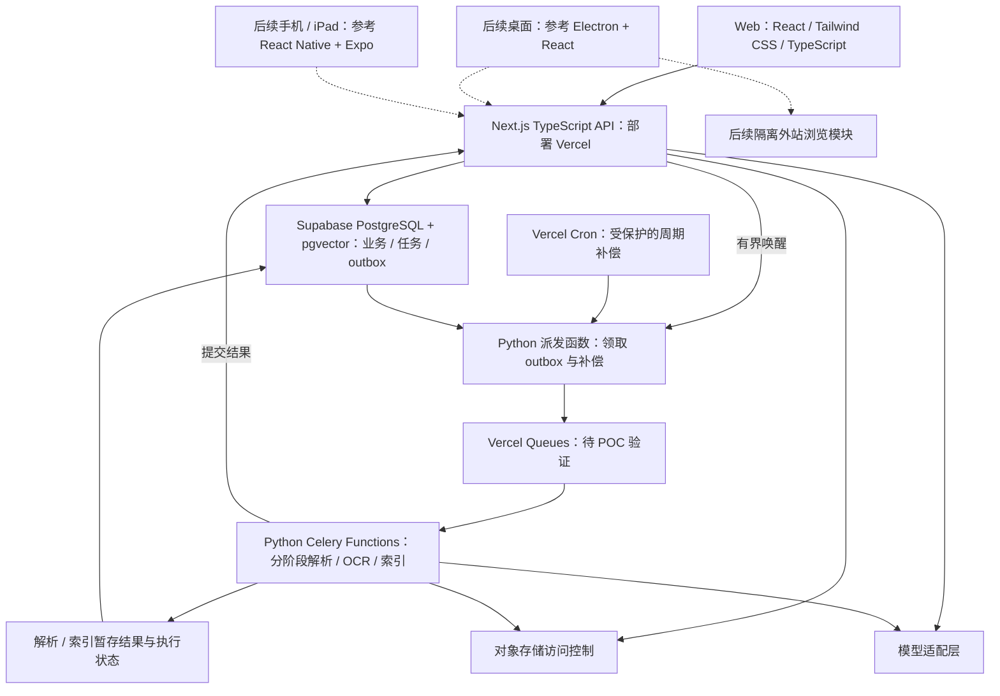

# Conuo（可诺）技术选型与架构说明

> 陪你把知识学会。

| 文档属性 | 内容 |
|---|---|
| 版本 / 日期 | v0.5 / 2026-09-12 |
| 选型状态 | 用户确认 React + Tailwind CSS + TypeScript 前端、Next.js TypeScript 后端、Supabase 数据库与 Vercel 部署；保留 Python 处理层 |
| 实现状态 | 文档设计阶段；没有创建应用代码、启动服务或完成技术原型 |
| 对应需求 | [PRD](PRD.md) 第 7—12、15—17 节 |
| 当前交付范围 | 用户已确认第一版只做 Web；其他平台在 Web 功能基本完善后再启动 |

本文区分两类内容：第 1 节的 Web 首版基础技术栈是已确认方向，桌面与移动路线留到后续平台启动时复核；具体模块拆分、目录结构和实现规则是工程建议，尚待原型验证。Celery / Vercel Queues 接入须通过 POC-05。Supabase 本次仅确认数据库，Auth、Storage、Realtime 仍待选择。

**实施顺序：先交付并完善 Web，再评估其他平台的迁移或重新实现。** 文中的桌面、移动与 iPad 设计保留为后续参考，首版不安排原生端工程、组件选型验证、签名和打包。清晰的服务端数据与 API 契约服务于当前 Web，也为后续接入保留空间。

## 1. Web 首版技术栈与后续参考

| 范围 | 技术选择 | 主要职责 | 使用边界 |
|---|---|---|---|
| Web 前端 | React + Tailwind CSS + TypeScript，使用 Next.js | 资料库、阅读、笔记、知识页与 AI 对话页面 | 响应式 Web；页面与业务 API 位于同一 Next.js 工程 |
| 后续 Windows / macOS | 此前 Electron + React 路线作为参考 | 未来桌面多栏、本地文件与内置浏览 | 首版不开发；平台启动时根据 Web 成果复核复用与重新实现范围 |
| 后续 Android / iPhone / iPad | 此前 React Native + Expo 路线作为参考 | 未来触摸阅读、移动收集与系统分享 | 首版不开发；原生阅读、分享和笔迹在平台启动后验证 |
| Web 编辑器 | Tiptap | 富文本笔记和知识页编辑 | 先验证 Web 体验；后续平台的使用方式另行评估 |
| Web PDF 阅读器 | PDF.js | PDF 展示、文本层与阅读基础 | 批注、位置映射、跨版本引用和回跳由项目设计实现 |
| 业务服务端 | Next.js + TypeScript，Node.js Route Handlers | 账号权限、资料与笔记、同步、交互 AI 问答、任务创建与结果发布 | 提供稳定 HTTP API；后台文档处理独立于交互请求 |
| Web / 业务 API 部署 | Vercel | Next.js 构建、页面交付与服务端函数运行 | 具体项目配置、地区与套餐待定；后台接入见第 6、9 节 |
| 业务数据与向量 | Supabase 托管 PostgreSQL + pgvector | 笔记、版本、资料关系、内容块、标签、任务记录和向量索引 | 需配置数据库权限、连接池和索引；检索质量须实测 |
| 大文件存储 | 对象存储 | 原始文件、网页快照、附件与派生文件 | 厂商、地区和套餐待定；数据库保留对象元数据与权限 |
| 后台处理语言与任务层 | Python + Celery | 文件解析、OCR、向量化和耗时知识整理 | 保留已有处理层方向；Vercel 部署适配是待验证工程方案 |

基础能力参考：[Tiptap 的 React 集成](https://tiptap.dev/docs/editor/getting-started/install/react)、[PDF.js 项目说明](https://mozilla.github.io/pdf.js/)、[pgvector 官方仓库](https://github.com/pgvector/pgvector)。这些来源说明组件用途，不证明 Conuo 的阅读、检索或学习质量已经达标。

Supabase 的 PostgreSQL 可使用 pgvector 存储和查询向量；选用该扩展不等于自动完成文档解析或 AI 标注。[Supabase pgvector 说明](https://supabase.com/docs/guides/database/extensions/pgvector)

具体依赖版本在初始化工程时选择相互兼容且受维护的版本，并写入锁文件。Supabase 与 Vercel 已由用户指定；登录、对象存储和模型服务不随之自动确定，服务地区与套餐在接入前落实。

## 2. 选择这条路线的理由

### 2.1 后续手机和平板参考路线

手机和平板独立客户端在 Web 功能基本稳定后再启动。届时针对触摸、键盘、拍照与系统导入设计界面，评估 React Native + Expo 是否适合复现 Web 已验证的功能。首版响应式 Web 与原生客户端分别验收。

React Native 的 Windows、macOS 和 Web 实现存在，但属于独立维护的平台扩展。此前桌面路线采用 Electron，后续启动时仍需根据实际功能复核，不能把移动库的可用性直接外推到桌面。[React Native 官方平台说明](https://reactnative.dev/docs/out-of-tree-platforms)

### 2.2 Web 先实现，后续按需复用

首版先在 Next.js 中实现资料列表、知识页、编辑器及 AI 对话。后续若采用 Electron，可提取适合共享的 React 客户端组件；确需共享时再隔离 Next.js Server Components、会话与服务端路由依赖。桌面窗口、本地文件、快捷键和外站浏览的适配层在对应平台启动后实现。

React 负责组件，TypeScript 负责类型，Tailwind CSS 负责 Web 样式；Next.js 提供路由、渲染与服务端入口，这些选型组合在同一工程。后续若提取共享组件，再验证不同客户端的样式构建；React Native 原生样式及 NativeWind 等库届时评估。[Tailwind CSS 的 Next.js 集成](https://tailwindcss.com/docs/installation/framework-guides/nextjs)

若后续采用 Electron，参考方案是本地 React 入口和缓存适配层连接远程 Next.js API。Next.js 静态导出不能保留依赖服务端运行时的功能，迁移时需识别这些边界，不能把完整 Web 服务直接当作桌面离线包。[Next.js 静态导出说明](https://nextjs.org/docs/app/guides/static-exports)

Electron 随应用包含 Chromium 和 Node.js，并提供 WebContentsView 以承载网页。此前选型主要考虑文档界面复用及外站浏览，后续仍需评估运行时体积、资源开销与更新维护。[Electron 简介](https://www.electronjs.org/docs/latest)、[WebContentsView](https://www.electronjs.org/docs/latest/api/web-contents-view)

### 2.3 备选方案的位置

Tauri 与 Flutter 是讨论过的替代方案，本版不同时维护多套客户端路线。Tauri 使用系统 WebView，若以后安装体积成为主要问题，可基于实际目标网站与编辑器测试重新评估；Flutter 覆盖多种平台，若团队条件或产品交互方向改变，也可另立选型记录。[Tauri WebView 说明](https://v2.tauri.app/reference/webview-versions/)、[Flutter 平台支持](https://docs.flutter.dev/reference/supported-platforms)

更换方案应由未通过的原型或实际维护成本驱动，并记录迁移范围；不能只凭框架宣传中的“一套代码多端”作决定。

### 2.4 Next.js 统一 Web 与业务 API

用户已决定采用 Next.js。其 Route Handlers 能提供由各类客户端访问的 HTTP 接口；本项目用它承接账号权限、资料、笔记、同步及交互问答。Server Actions 仅作为 Web 页面内部交互的可选实现，不承担全部客户端唯一接口的角色。[Next.js 后端接口说明](https://nextjs.org/docs/app/guides/backend-for-frontend)

该 Next.js 工程部署到 Vercel，首版只交付 Web。后续客户端可以访问其业务 API，安装包届时按平台构建与发布。Vercel 对 Next.js 的部署及流式响应提供框架集成，实际配置与链路表现仍须验证。[Next.js on Vercel](https://vercel.com/docs/frameworks/full-stack/nextjs)

该选择便于 Web 与业务服务围绕 TypeScript 组织，代价是任务处理层仍使用 Python，需要维护跨语言契约和明确的数据写入责任。框架不会替代持久任务队列、数据库、对象存储或云同步协议。

## 3. 建议架构与责任边界



图示表达本版建议的 Vercel 部署路径，队列接入须经 POC-05 验证。Next.js Web 与业务 API 位于同一工程，Python 派发与 Celery 任务位于同一处理层代码库，分别以有界函数执行。为便于隔离构建，可先规划同一仓库对应两个 Vercel 项目：Web 工程与 Python 处理层；此为工程建议，尚未创建云项目。两种语言通过契约和受限数据接口协作，不共享运行时领域对象或同一套 ORM 实体。结果发布失败时由持久状态与补偿机制恢复。

| 模块 | 负责 | 不承担 |
|---|---|---|
| 客户端 | 展示、用户输入、草稿与本地缓存、调用受控接口 | 保存服务端模型密钥；自行决定服务端权限 |
| Next.js 业务层 | 权限判定、业务规则、版本写入、交互问答、创建任务及发布处理结果 | 在请求进程中执行耗时 OCR 或批量索引 |
| Python 派发函数 | 有界领取待派发记录、调用 Celery 客户端、补偿遗漏投递与结果提交 | 自行创建未经授权的业务任务；以入队成功代替处理成功 |
| Celery 处理函数 | 校验任务、执行阶段任务、保存暂存结果与执行状态、提交结果 | 直接覆盖用户笔记；自行发布未经最新权限和版本校验的结果 |
| Supabase PostgreSQL | 业务数据、任务状态、版本与引用依据 | 保存所有原始大文件；自动判断应用账号权限 |
| pgvector | 语义召回的索引 | 原始资料唯一副本；最终答案正确性的证明 |
| 对象存储 | 文件字节与版本对象 | 自动解决笔记同步、引用失效或访问授权 |
| Vercel Queues（待验证） | 传递任务并触发处理函数 | 替代业务任务状态、幂等与重试规则 |
| Redis（备选） | 常驻处理层备选方案的 broker | 当前 Vercel 首选路径的必需依赖；用户内容唯一副本 |

### 3.1 各端统一 HTTP API

资料、笔记、同步、任务查询和 AI 问答通过版本化 HTTP API 提供，建议使用 `/api/v1/` 路径。接口规定请求与响应结构、鉴权、错误码、幂等键和流式事件格式。首版供 Web 使用，后续平台可接入同一业务服务；Route Handlers 与可选的 Server Actions 共用服务端领域函数，避免复制权限、额度和版本规则。

每个业务入口都在服务端进行账号和对象权限检查。首版落实 Web 会话；移动 / 桌面凭证在后续平台启动时设计，不能默认浏览器 Cookie 自动适用于原生客户端。内部 worker 结果提交接口采用单独服务身份及受限权限，其接入方式待实现时核验。

Python 派发入口仅接受受信服务或定时补偿调用。若使用两个 Vercel 项目，普通 HTTP 入口不因名称含“internal”而自动私有；派发和回调两方向都须验证服务身份、允许的任务及环境。用户客户端只调用 Next.js，不直接接触队列或 Python 控制入口。

### 3.2 数据写入与迁移责任

| 数据范围 | 写入责任 | 并发与权限边界 |
|---|---|---|
| 用户、空间权限、资料元数据、笔记与同步版本 | Next.js 业务层 | 所有写入经过业务鉴权、版本与额度规则 |
| 业务任务、待派发记录、取消请求 | Next.js 创建；派发器领取和更新派发状态；worker 更新受限执行状态 | 明确状态转换与任务身份，不能各语言任意修改所有字段 |
| 解析块、向量与派生文件暂存结果 | Python worker | 只写当前任务及处理尝试对应的输出，绑定资料版本，完成后尚不可直接发布 |
| 正式可用索引、知识草稿、成功状态与业务结算 | Next.js 结果提交处理 | 在同一事务内重查资料版本、权限及取消状态，AI 任务额外检查 AI 许可，再发布当前任务结果；普通索引不因关闭 AI 被拒绝，不直接覆盖用户正文 |

数据库 schema 与迁移只有一个权威来源，建议集中到 `packages/database`，由单一迁移流程维护。TypeScript 和 Python 按同一 schema 与版本化数据契约读写，不各自生成互相覆盖的迁移。ORM、迁移工具、事务隔离与锁策略尚未确定，但发布时的校验与写入必须具备原子性。

### 3.3 Supabase 数据库接入

Supabase 承担现有 PostgreSQL 的托管职责；原文件仍进入对象存储。资料、解析块及后续检索块、标签、引用、向量和业务任务在数据库中建立关系。切块策略、块级标签与检索融合参数仍需单独细化，换用托管数据库不代表这些功能已经实现。

Vercel 上的 Next.js 与 Python 函数建议通过 transaction pool 访问数据库，限制每个实例的应用连接池，并按驱动关闭不兼容的 prepared statements。事务内完成任务与 outbox 的原子写入，避免依赖跨事务会话状态；迁移使用单独、受控的连接配置，并核验网络与驱动兼容性。[Supabase 连接指南](https://supabase.com/docs/guides/database/connecting-to-postgres)

业务 schema 默认不向客户端的 Data API 暴露；所有业务修改由 Next.js 接口处理。若以后开放表、视图或 RPC，必须同时配置 grants、RLS 和对应隔离验证。数据库密码、服务端 secret / service-role 密钥不进入浏览器、桌面或移动安装包；高权限服务身份可能绕过 RLS，不能仅凭“已开启 RLS”推断所有访问均隔离。[Supabase API 安全](https://supabase.com/docs/guides/api/securing-your-api)、[RLS 权限边界](https://supabase.com/docs/guides/database/postgres/row-level-security)

本项目建议为 Next.js、Python 派发与执行、迁移流程分别定义最小数据库权限。通过 SQL 连接时不会自动获得应用登录用户身份；账号条件与对象范围由受信服务核验并传入查询，若采用按账号 RLS，需明确事务内身份上下文及连接复用时的隔离。权限约束同样覆盖向量检索、标签筛选与结果发布。

迁移在受控流程中执行，不由每次页面构建、预览部署或用户请求自动改写正式数据库。开发、预览和生产的数据库及处理环境须隔离；具体实现可选择独立项目或适用的隔离能力，套餐与恢复方案接入前核验。

## 4. 代码复用与建议目录

以下为 Web 与后台工程的建议结构，**尚未创建这些代码目录**。先按 Web 实际模块组织，`packages` 只在边界明确或确需复用时提取，不要求一次搭建所有包：

```text
conuo/
├── apps/
│   └── web/                # React / Tailwind / TypeScript 页面与 Next.js API，部署 Vercel
├── packages/
│   ├── contracts/          # 版本化 OpenAPI / JSON Schema、任务与结果契约
│   ├── api-client/         # 客户端接口封装与错误处理
│   ├── domain/             # Web 的可移植纯 TypeScript 规则，按需提取
│   ├── server-domain/      # 仅 Next.js 服务端使用的权威业务规则
│   ├── database/           # Supabase PostgreSQL 权威 schema 与迁移来源
│   ├── web-ui/             # Web React DOM 组件与 Tailwind 样式，按需提取
│   └── design-tokens/      # 色彩、间距与排版变量
├── services/
│   └── processing/         # Python 处理层，建议独立 Vercel 项目
│       ├── dispatcher/     # 受保护的有界派发与补偿入口
│       ├── workers/        # Vercel Celery 订阅入口、阶段任务与结果提交
│       ├── contracts/      # 从权威契约生成或校验的 Python 数据结构
│       └── adapters/       # 文件解析、对象存储和模型接口
└── docs/                   # PRD 与技术方案
```

建议用单一仓库管理，TypeScript 工程和 Python 处理层各自锁定依赖。Next.js 的页面与 API 使用其构建体系；首版不创建 `apps/desktop`、`apps/mobile` 或原生构建配置。包管理器、构建编排工具、ORM 和迁移工具在初始化时再确定；后续平台启动后再扩展目录与构建工具。

后续优先评估复用契约、数据、可移植规则与接口封装，界面可按平台重新实现；不以复用率作为 Web 首版验收指标。React DOM 组件不能未经处理直接用于 React Native；`server-domain` 和数据库访问代码不能打包进客户端。Next.js 负责最终权限、版本与额度判定，Python 执行层按契约读取必要状态，不能直接导入 TypeScript 业务对象。

跨语言任务与结果采用版本化 JSON 契约，至少包含 schema 版本、任务 ID、执行尝试 ID、账号 / 空间 / 资料版本标识、处理配置和幂等键。身份字段只是任务上下文，不替代鉴权；TypeScript 与 Python 分别从同一契约生成或校验数据，协议不兼容时明确失败，不能静默忽略关键字段。

## 5. 阅读、编辑与浏览实现边界

### 5.1 阅读和引用

首版从 Web 的 PDF.js 原型开始。后端解析结果至少保留资料 ID、资料版本、页码及可用的位置标记；Web 批注和 AI 引用使用同一套定位契约。页内坐标、文本偏移及解析块之间如何映射，由 POC-01 确定，不能只保存页码或一次渲染时的屏幕坐标。桌面与移动阅读器在后续启动时对接此契约。

原文件更新后不得把旧引用悄悄指向新版的相似文字。引用随原资料版本回跳，过期与不可用状态按 PRD 展示。扫描件的展示和 OCR 是否成功分开记录。

### 5.2 笔记与移动端编辑

Tiptap 首先用于 Web，采用可版本化的文档结构。首版验证中文输入法、选区、自动保存、重载及短暂断网后的草稿恢复；手机和平板浏览器按 Web 响应式范围验证。服务端校验节点和附件引用，导入或渲染外部内容时不直接信任原始 HTML。

后续移动客户端启动后，可验证 WebView / Expo DOM 编辑区或原生阅读组件。前者能复用部分 Web 内容，但有独立执行环境和异步数据传递边界，不能假设与原生界面直接共享全局状态。[Expo DOM 组件说明](https://docs.expo.dev/guides/dom-components/)

后续平台的 POC-06 包含中文输入法、选区、软键盘遮挡、长文滚动及切后台后的草稿恢复，并独立验证 iPad 手写与 PDF 缩放对齐。原生缓存和笔迹组件届时选择，不作为 Web 首版启动或发布条件。

### 5.3 内置浏览器

首版只实现 Web 的链接导入、阅读快照和外部打开。以下桌面与移动浏览容器规则保留到对应平台扩展时实施；不在 D0 或 M0 创建原生浏览器原型。

- 桌面在独立的 WebContentsView 中加载外站；应用资料界面与外站属于不同的权限边界。
- 外站禁用 Node.js 集成，启用上下文隔离与进程沙箱。导航、弹窗和权限申请受控，不向网页暴露通用文件系统或高权限应用接口。[Electron 安全说明](https://www.electronjs.org/docs/latest/tutorial/security)
- 移动端使用相应的网页承载能力，具体组件与系统登录、下载、弹窗行为通过 POC-02 确定。浏览 Cookie 不进入资料云同步，应用登录凭据不向外站传递。
- Web 端保留链接导入、阅读快照和外部打开；受站点嵌入策略限制，不保证任意网址在页内打开。[MDN：X-Frame-Options](https://developer.mozilla.org/en-US/docs/Web/HTTP/Reference/Headers/X-Frame-Options)
- 打开网页、提取正文、将正文用于 AI 是三个独立状态。登录后可阅读的页面不等于后端可以直接获取；优先由用户在当前浏览会话中主动保存可提取内容，并明确失败状态。

网页文字和上传文档均作为资料处理，不作为控制应用权限、工具或后台任务的指令。

## 6. 数据、检索与后台作业

### 6.1 一份资料的处理流程

1. Next.js 业务层校验用户、空间权限、文件类型和当前额度，创建资料及上传记录。
2. 客户端使用受限上传凭证直传对象存储；Next.js 确认对象存在、归属、大小和类型等实际属性与记录匹配后登记版本。凭证限制对象路径、有效期及可用操作；不信任客户端单独提交的“上传成功”。
3. Next.js 在 Supabase 同一数据库事务中创建业务任务及待派发记录。事务提交后可有界调用 Python 派发入口以降低排队延迟，调用失败由补偿恢复。Python 领取记录，使用 Celery 原生客户端经 Vercel 适配投递；任务只携带对象标识与必要配置，不把整个文件塞进队列。
4. worker 检查任务、资料版本和当前处理条件后，按资料处理设置执行非 AI 的文本解析和普通关键词索引，保存带来源位置的暂存内容块与解析覆盖状态。OCR 若需要模型参与，也须先检查用户已启用 AI 且资料允许用于 AI。
5. 仅在用户已启用 AI 且资料允许用于 AI 时执行向量化、模型辅助检索准备及生成任务。worker 提交暂存结果后，由 Next.js 按第 3.2 节重新校验并发布。普通搜索可用状态与 AI 可用状态分别记录，关闭 AI 不隐藏普通搜索中的资料。
6. 用户提问时重新校验范围与权限，检索候选内容，结合来源生成回答与可回跳引用。
7. 保存知识页时记录所用来源版本；原资料删除、禁用或更新后按 PRD 更新派生内容状态。

### 6.2 检索设计

pgvector 用于语义召回；标题、术语和精确短语需要关键词检索补充。中文分词及关键词检索方案应使用真实中英文材料评估，不能默认 PostgreSQL 的任一内置语言配置适合中文。

在 Supabase 的实际扩展版本与数据量下验证权限、资料状态和标签筛选后的召回；不先取全库近似结果再在客户端过滤。受约束查询的性能与召回由 POC-04 验证，数据库供应商不替代检索质量评估。

普通关键词搜索按用户、空间、资料存在状态与可检索内容授权；AI 禁用本身不隐藏标题、标签、普通正文搜索和资料管理入口。向量化、模型辅助检索及 AI 问答额外检查用户已启用 AI、资料版本有效且资料允许用于 AI，遵循 PRD 的 SRC-01—SRC-03。

AI 回答输出前应重新检查来源是否仍可用，避免请求执行期间删除或禁用的内容被继续用于 AI。嵌入模型更换时记录索引版本并安排重建，不混用不兼容的向量空间。

首版先验证可解释的检索、引用和知识页更新，不因产品使用“知识库”一词就额外引入图数据库或复杂 Agent 框架。知识之间的关联可先通过关系数据表达，是否需要新基础设施由实际查询和数据量决定。

### 6.3 交互问答与长任务

交互问答由 Vercel 上 Next.js 的 Node.js Route Handler 提供流式响应，首版验证事件格式与 Web 浏览器兼容性；原生传输适配留到后续平台。后台处理独立于交互请求。函数的流式响应与队列处理都需要核验时长、内存、包体和临时存储边界；大文件直传对象存储，函数只接收控制请求并按需读取文件。[Vercel Functions 限制](https://vercel.com/docs/functions/limitations)

Vercel 官方 Celery 适配可使用 `vercel://` broker 将 Python 任务交给 Vercel Queues，再触发私有 Python Function；队列处于 Beta。本版建议优先验证此路径，Python 派发改为有界 HTTP 函数，Redis 不再是默认依赖。原 Redis + 常驻派发器 / worker 保留为 POC 未通过时的备选，具体调整另行记录。[Vercel Celery 部署说明](https://vercel.com/docs/frameworks/backend/celery)

任务的创建、运行、结果待提交、成功、失败与取消请求保存在 Supabase PostgreSQL。采用业务任务 ID、资料版本与执行尝试 ID 标识工作及输出；下列可靠性规则属于 Conuo 待实现方案：

1. **持久创建：** Next.js 同事务写业务任务与 outbox（待派发记录），不能先提交任务再仅依靠一次内存投递。
2. **跨语言派发：** Python 派发函数以有限批次领取到期记录，再调用 Celery 原生 Python 客户端；任务定义和订阅部署在同一 Python 项目。Next.js 不手工构造 Celery 消息信封；环境、队列和协议版本显式对应。
3. **重投与补偿：** 领取记录使用持久租约或等效并发保护；若发布后登记失败，允许再次投递，由任务幂等保护处理。恢复扫描覆盖租约过期、长时间无进展、函数超时和已暂存未发布的任务，入队成功不是最终完成依据。
4. **结果提交：** worker 持久化暂存输出与“结果待提交”状态，向受限的 Next.js 内部接口提交任务与输出标识。Next.js 校验服务身份，在事务内重查当前资料、版本、删除、取消及按任务类型适用的 AI 许可，再启用输出并记录成功与业务结算。被删除或已不适用的结果不发布；生成的知识内容遵守 PRD 草稿规则。
5. **提交恢复：** 若函数退出或结果提交失败，Python 补偿入口扫描已暂存的待提交任务并重试。重复提交使用同一幂等身份；陈旧执行尝试不能覆盖后续结果，原文被禁用 AI 时也不能通过旧任务重新参与 AI。
6. **分阶段处理：** 按资料类型将解析、必要 OCR、切块、向量批次和整理拆成有界阶段，记录检查点与子任务输出。只有当前版本所需阶段完成并通过发布校验，才能进入相应可用状态；部分成功仍按 PRD 显示覆盖范围。
7. **恢复调度：** Vercel Cron 调受保护入口进行有界补扫，每次读取 Supabase 的到期时间、租约和状态后继续处理；频率须满足恢复目标。长延迟重试保存在 `next_retry_at`，不通过在函数中等待实现。

双方只按第 3.2 节的职责写表，不各自维护一份相互冲突的任务真相。Next.js 发布结果不代表接受并合并知识草稿；用户接受知识页修改仍走独立业务操作。

Vercel Celery 适配的默认提前确认会影响超时后的重投，需要验证 `task_acks_late`、处理租约和显式异常重试；长 `countdown` / `eta` 会占住函数执行时间。上述配置必须与阶段幂等及补偿规则一起验证。[Celery 确认与重试](https://vercel.com/docs/frameworks/backend/celery#retries-and-redelivery)

Cron 不能作为精确、只调用一次的保证；漏调或重复调用均从持久状态恢复，记录长时间无进展的任务并提供重试入口。[Vercel Cron 管理](https://vercel.com/docs/cron-jobs/manage-cron-jobs)

Celery result backend 和 Runtime Cache 仅用于可丢弃的执行辅助信息。用户看到的任务状态、输出与用量以 Supabase 为准，不把临时缓存缺失解释为任务尚未执行，也不承诺模型调用只发生一次。[Runtime Cache](https://vercel.com/docs/caching/runtime-cache)

取消先改变业务任务状态，在执行阶段边界及写入前检查；即使供应商无法立即中断请求，也应停止向用户发布已取消的结果，并按实际发生的调用记录用量。模型调用、嵌入和重排序通过适配层接入，供应商仍待选择。

## 7. 云同步与离线方案

同步协议独立于 React、Expo、Supabase 和对象存储设计，继续遵守 PRD 第 10—11 节。选择 Supabase 数据库不代表已采用 Realtime，也不自动解决离线重放与冲突。

Next.js 的页面缓存和数据缓存不作为同步真相。账号私有资料、版本与权限结果不得被跨用户共享缓存；缓存策略在各接口明确声明，相关失效与隔离行为需要实测。

| 项目 | 本版实现方向 | 需要避免的问题 |
|---|---|---|
| 服务端版本 | 对象 ID、版本号、删除标记和变更游标 | 仅依赖客户端时钟决定覆盖顺序 |
| 本地修改 | 保存操作 ID、基准版本和待同步状态，允许幂等重放 | 断网后重复写入或覆盖另一设备新内容 |
| 冲突 | 首版保留冲突副本并让用户处理 | 静默丢弃用户内容；为了单人首版提前引入多人实时协同体系 |
| 离线资料 | M0 保护 Web 草稿；显式离线包在后续平台扩展时评估 | 自动把所有大文件同步到每台设备 |
| 缓存隔离 | 账号与空间隔离，退出、切换账号和删除后按规则清理或失效 | 用上一账号缓存展示或回答下一账号的问题 |
| 索引与派生数据 | 可重建，受原资料权限和版本约束 | 删除原文后仍通过旧索引、旧对话或知识页继续使用 |

首版选择 Web 本地存储并用两个隔离浏览器会话验证版本协议、重放与冲突；移动和桌面本地数据库留到相应平台启动后选择。对象存储里的文件同步不等于笔记内容、权限和学习进度同步。

## 8. 原型验证与交付顺序

执行 PRD v0.5 的 Web 优先范围：M0 首版 Web、M1 Web 功能完善、M2 学习增强，其他平台单独延期。首轮只做 Web 及后台适用的验证，原生端扩展与 POC-06 在对应平台启动后执行。

| 对应 PRD | 原型重点 | 达标证据 |
|---|---|---|
| POC-01 | Web PDF 选段、批注、编辑、带引用问答与原文回跳 | 中英文、基础表格、跨页段落样本可复演；记录输入、草稿恢复、文字缺失、位置漂移与旧版本引用行为 |
| POC-02 | Web 链接导入、阅读快照与失败降级 | 针对实际站点记录提取、快照、AI 可用与外部打开；Electron / 移动浏览容器留到后续 |
| POC-03 | 两个隔离 Web 会话的断网编辑、重放、版本冲突、删除与 AI 禁用 | 不静默丢失修改、不重复发布任务结果、不把已禁用资料重新用于 AI；普通搜索仍按权限可用，保留可复演记录 |
| POC-04 | Vercel 到 Web 的流式问答、Supabase 检索与隔离 | 使用 PRD 冻结评估集；验证连接池、受限角色、私有数据缓存、范围及标签筛选后的召回；记录浏览器首段、断流与取消 |
| POC-05 | Vercel Celery / Queues 接入、阶段执行、补偿与成本 | 复演 outbox 提交后退出、投递确认失败、函数超时、重复派发、Cron 漏调/重叠、结果暂存后回调失败与新旧部署协议交叠；验证真实解析依赖、包体、内存、时长、租约和实际用量 |
| POC-06（后续平台） | 手机 / iPad 原生输入、选区、分享、阅读与笔迹 | 相应平台启动后真机验证；不在 D0/M0 执行，不阻塞 Web 首版 |

建议执行顺序：

1. **D0：** 只做 Web 阅读、编辑、引用、导入、数据保存与后台任务原型。
2. **M0：** 完成首版 Web 的“导入 → 阅读提问 → 引用回跳 → 保存知识页 → 另一 Web 会话接续”流程，按 Web 范围验收。
3. **M1：** 持续完善 Web 功能、交互与稳定性，按试用反馈逐步加入 OCR、多格式、全库搜索和后台整理等增强。
4. **M2：** 按学习价值在 Web 上增加练习、复习与反馈，不要求先交付其他客户端。
5. **后续平台扩展：** Web 核心功能基本稳定后再决定平台优先级，复核参考技术、复用与重新实现范围，执行该平台原型和独立验收；不随 M0 结束自动启动，也不要求全部 M2 探索完成。

首版只要求 Web 与后台对应的构建、兼容性和发布准备。原生签名、安装、升级、真机与商店发布留到对应平台扩展，资源与时间届时安排。本文不指定工期，也不启用云构建、付费服务或线上资源。

## 9. 已定与待定事项

| 状态 | 内容 |
|---|---|
| 已确认 | 第一版只做 Web；React / Tailwind CSS / TypeScript 前端、Next.js TypeScript 后端、Supabase 数据库与 Vercel 部署 |
| 当前待原型确定 | Web 阅读与编辑、浏览器存储与多会话同步、流式链路；Vercel Celery / Queues Beta 接入、任务分阶段与恢复 |
| 后续平台启动时复核 | Electron / React Native / Expo 参考路线、原生 PDF / 编辑、WebView、分享、笔迹、本地数据库与各平台构建 |
| 待工程初始化确定 | 依赖版本、包管理器、ORM、迁移工具、构建测试工具、Vercel 项目拆分与受限服务调用配置 |
| 待外部接入前确定 | 登录、对象存储、模型与嵌入服务、各服务地区、配额、套餐与预算；Supabase Auth / Storage / Realtime 仍未确认 |
| 待排期确定 | Web 实施团队与日期；其他平台在 Web 功能基本稳定后再确定顺序、设备及构建资源 |

这些待定项不阻碍按已选技术路线设计和验证，但不得在未核验前写成已实现能力。具体功能范围、数据规则和验收门槛继续以 [PRD](PRD.md) 为准；本文件承接技术实现方向。

### 9.1 部署与运行约束

Web 与 Next.js TypeScript 业务 API 部署到 Vercel，使用 Node.js 运行时；数据库由 Supabase 托管。Python 处理层优先按第 6.3 节验证 Vercel 的函数与队列接入，不能沿用常驻循环、进程内计时器或本地磁盘作为可靠任务状态。需要持续执行的工作先分阶段持久化；无法满足函数条件的解析任务再形成针对性调整方案。

建议将 `apps/web` 与 `services/processing` 分别配置为同一仓库中的两个 Vercel 项目，以隔离 Next.js 和 Python 的构建与环境变量；Python 薄 HTTP 入口只负责派发及补偿，客户端业务后端仍为 Next.js。派发与 worker 应在同一 Python 项目内使用一致的任务、队列和部署配置；跨项目回调地址、鉴权、预览保护和版本兼容由 POC-05 核验，不通过临时预览 URL 向正式环境提交结果。

队列发布成功或 Celery 返回成功不等于 Conuo 已发布资料。Supabase 保存检查点、待提交结果与业务状态；换部署、函数退出或缓存失效后仍可恢复。上线配置须核验队列保留期、确认策略、重试、Cron 频率及 Beta 能力的实际可用性；未通过时保留 Redis 常驻备选的设计记录，不自动购买或启用替代资源。

Vercel 函数区域与 Supabase 数据库区域需结合实际网络和调用链选择；面向中国用户的登录、上传、阅读、问答首段与失败率使用目标网络验证，不以平台的全球部署能力代替产品实测。开发、预览与生产的数据库、对象路径、队列、服务身份和回调目标分别隔离，防止预览任务写入正式资料。

对象存储服务尚未指定，Supabase Storage 可列为候选；一旦选择，再验证私有文件授权、直传、大文件恢复和删除语义。登录服务同理，不能把选定 Supabase 数据库写成已选定 Supabase Auth。具体地区、域名、套餐与函数配置尚未确定；本轮没有创建项目、凭据、部署或付费资源。

## 10. 变更记录

| 日期 | 版本 | 变更 |
|---|---|---|
| 2026-09-12 | v0.2 | 根据用户对技术栈建议的确认建立本文；明确跨端复用、外站浏览、数据职责、后台任务、同步及原型验证边界 |
| 2026-09-12 | v0.3 | 用户确认 Web 与业务 API 改用 Next.js，替代原 React + Vite Web / FastAPI 业务后端；保留 Python + Celery 处理层，补充统一 HTTP API、outbox 派发、结果发布、迁移责任与部署边界 |
| 2026-09-12 | v0.4 | 用户指定 React + Tailwind CSS + TypeScript、Supabase 数据库与 Vercel 部署；补充托管数据库与跨端样式边界；依据当前官方能力提出 Vercel Celery / Queues 适配及原型门槛，将 Redis 常驻方案降为备选 |
| 2026-09-12 | v0.5 | 用户明确 Web 首版与后续扩展顺序；移除 D0 原生原型安排和 M1 多端交付要求；当前目录、POC 与同步验证聚焦 Web，其他平台技术保留为后续复核参考 |

**文档终态：** 技术路线已确认并落入文档；所有实现、性能与质量结论仍待开发和实测。本轮没有创建应用代码、启动服务、提交、推送或部署。
